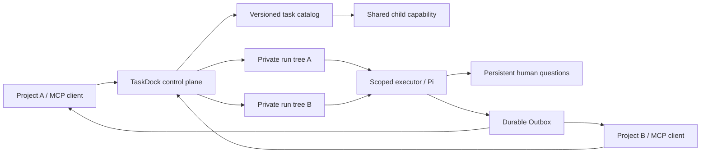

<div align="center">

# TaskDock

### Share agent capabilities. Keep every request private.

A local-first control plane for reusable, versioned task agents — with isolated runs, scoped authorization, durable recovery, and human handoffs.

[](LICENSE)
[](https://nodejs.org/)
[](#status-and-boundaries)

**English** · [简体中文](README.zh-CN.md)

[Quick start](#quick-start) · [How it works](#how-it-works) · [MCP integration](#connect-an-mcp-client) · [Contributing](CONTRIBUTING.md)

</div>

## Your release-check agent should work across projects

You build a useful agent in one chat. The next project needs the same checks, but its rules, history, tools, and upgrades are trapped in that chat.

TaskDock turns recurring **task types** into services. A caller discovers an existing capability, submits a private request, and receives a versioned result. Unmatched work stays with the caller.

For example, two projects can share a release-check capability without sharing their deployment logs. A stricter project can fork that capability and explicitly switch its reference; other callers keep their existing version.

> **Capabilities form a shared DAG. Each invocation gets a private request tree.**

## What you can do

| Capability | Behavior |
| --- | --- |
| Reuse tasks across projects | Discover and invoke stable task services through MCP or HTTP. |
| Compose and specialize | Pin child releases by digest; derive an independent task with provenance. |
| Upgrade deliberately | Edit draft → test the exact bundle → promote to stable, with per-task Git history. |
| Keep requests separate | Pin capability snapshots and project only declared input fields into child runs. |
| Recover interrupted work | Persist attempts, checkpoints, tool intents and receipts; reconcile uncertain actions. |
| Bring a human back in | Persist typed questions and resume the same request after answers arrive. |
| Receive results reliably | Pull a durable inbox; deduplicate message IDs and ACK/NACK deliveries. |
| Improve through review | Turn experience into proposals; approval changes draft, never silently changes stable. |
| Share capability packages | Export allowlisted configuration to a self-hosted Registry; omit request history and credentials. |

## Quick start

Requires **Node.js 24+**, npm, and Git. No model key is needed for the deterministic examples.

```sh
git clone https://github.com/hexiao160705-dev/taskdock.git
cd taskdock
npm ci
npm run local:start
npm run demo:reliability
```

Use the header language button for English / 简体中文. Authored task content stays in its original language.

Open **[localhost:4640/#graph](http://127.0.0.1:4640/#graph)**. The independent Registry runs at [localhost:4641](http://127.0.0.1:4641).

Try this path:

1. Inspect the shared evidence-check child used by multiple parent tasks.
2. Open the human-wait demo and submit a stable request.
3. Answer its required question. The child receives only the explicitly mapped evidence.
4. Open Deliveries, receive the messages, and ACK them.
5. Fork the shared child, edit its rules, test and promote it, then explicitly rebind one parent.

The built-in checks validate supplied input. They do **not** inspect a real deployment or substitute for model reasoning. For the detailed walkthrough, see [the demo guide](docs/DEMO-0.2.md) (Chinese).

```sh
npm run local:stop   # Stop only services recorded for this checkout
npm start           # Alternatively run the control plane in the foreground
npm run registry    # Run the Registry separately
```

Background services depend on this computer staying online. This is not a production daemon or hosted service.

## How it works



The control plane owns task definitions, release gates, authorization, run state, and delivery. The executor receives its pinned capability, approved knowledge, and its own request evidence. It does not load other runs or ambient user agent settings.

SQLite transactions couple terminal state with Outbox messages. Leased, fenced attempts prevent stale workers from committing results. A successful tool receipt can be reused; an uncertain external action waits for reconciliation instead of being blindly repeated. Delivery is **at least once**, not exactly once.

**Stack:** Node.js · SQLite/WAL · Git · Pi SDK · MCP SDK · plain HTML/CSS/JavaScript.

[English technical guide](docs/TECHNICAL-GUIDE.md) · [Architecture](docs/ARCHITECTURE.md) · [Protocol](docs/PROTOCOL.md) · [Reliability contracts](docs/RELIABILITY.md) (detailed design notes currently in Chinese).

## Connect an MCP client

Start TaskDock first. Configure your client to launch the thin stdio adapter:

```toml
[mcp_servers.taskdock]
command = "node"
args = ["/absolute/path/taskdock/src/mcp-stdio.js"]
```

Replace the path with your checkout. For a different server address, set `TASKDOCK_URL` in the adapter environment. Streamable HTTP is available at `http://127.0.0.1:4640/mcp`.

The 12 tools use the `taskdock_` prefix: `search`, `plan`, `open_session`, `submit`, `get_run`, `list_runs`, `cancel_run`, `retry_run`, `answer`, `receive`, `ack`, `nack`.

Use the [client skill](skills/taskdock-client/SKILL.md) for calling discipline. The service enforces authorization and isolation; a skill is not a security boundary.

## Use your own model and tools

Copy `.env.example` to `.env`, restrict its permissions (`chmod 600 .env` on macOS/Linux), and configure your own provider key. In a task, select the `pi` runner, model, credential environment-variable name, and optional serial Team stages.

Only explicitly configured HTTP MCP endpoints and allowlisted tools are connected. Store credential **values** in the local environment, never in task manifests or Git. TaskDock does not borrow credentials from other applications.

## Status and boundaries

**Early preview, single-maintainer, local-first.** This is working prototype infrastructure, not a production multi-tenant platform.

- Application-level caller isolation is implemented. A local administrator can inspect histories; this is not an OS sandbox against malicious plugins or users.
- Built-in runners are deterministic. The Pi integration has offline SDK/provider tests; live-model quality has not been validated by those tests.
- Shared child dependencies work locally. Composite packages with instance-specific release references cannot yet be distributed portably.
- The Registry is self-hosted. There is no hosted public marketplace, billing service, or automatic public deployment.
- Team execution uses explicit serial stages. Distributed scheduling, dynamic parallel teams, and A2A compatibility are future work.

The 0.2 baseline passed **44 backend/protocol/offline SDK checks**, including three real SIGKILL recovery cases using a local side-effect stand-in. Desktop native UI automation is recorded separately from human acceptance. See [verification and blind spots](docs/VERIFICATION-0.2.md).

## Development

```sh
npm test
npm run check
npm run backup
```

Runtime data lives under `.data/` and is excluded from Git. For a coordinated database-and-file restore point, stop both services before backup. Never attach raw request histories, `.env`, credentials, or private browser captures to issues.

[Contributing](CONTRIBUTING.md) · [Security](SECURITY.md) · [Roadmap](ROADMAP.md) · [Documentation index](docs/INDEX.md)

## Help shape TaskDock

Useful contributions include a reproducible real-task evaluation, a recovery edge case, a clearer onboarding flow, or a scoped integration. Start with an issue describing the task, expected behavior, and redacted evidence.

If this approach helps your workflow, a star helps others discover it. Feedback from real use is especially valuable at this stage.

## Acknowledgments and license

TaskDock uses [Pi](https://github.com/badlogic/pi-mono) for its model execution integration and the [Model Context Protocol SDK](https://github.com/modelcontextprotocol/typescript-sdk) for interoperability. Reliability design was informed by studying [DeepSeek's superagent prototype](https://github.com/deepseek-ai/dsh-superagent-prototype); TaskDock is an independent implementation, not an official DeepSeek project.

[MIT](LICENSE). Third-party dependencies retain their respective licenses.
